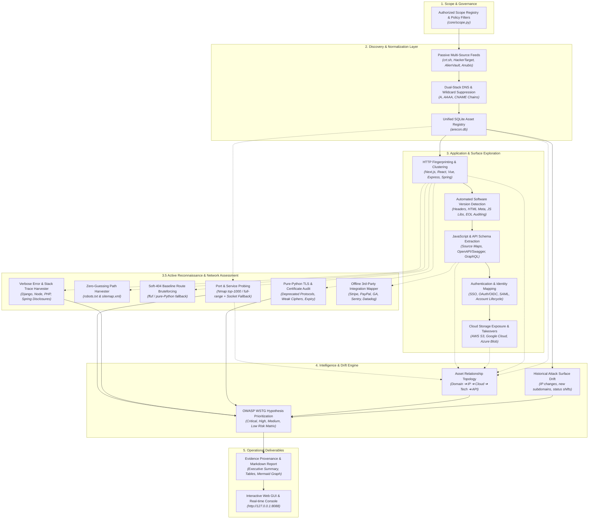

# ARECON 2.0 — Advanced Attack Surface Management & Reconnaissance Framework

<p align="center">
  
  
  
  
  
</p>

---

## 📖 Overview

**ARECON 2.0** is an enterprise-grade, continuous attack surface management (ASM) and automated reconnaissance framework architected by **Rakshit Walia**. Designed specifically for authorized bug bounty hunters, penetration testers, and defensive security operations, ARECON bridges the gap between passive intelligence gathering and controlled, safe active validation.

Centering around a **normalized SQLite asset store (`arecon.db`)**, ARECON correlates findings across multiple independent discovery sources, resolves dual-stack DNS with wildcard suppression, clusters modern web frameworks, audits software versions, extracts client-side API schemas, monitors cloud storage exposure, and scores hypotheses against the **OWASP Web Security Testing Guide (WSTG)**.

---

## 🎨 Clean UI Theme: White, Red, Black

ARECON features two user interfaces designed for clarity and operator focus:
* **Background:** Clean White (`#FFFFFF`)
* **Interactive Elements / Action Buttons:** Vibrant Red (`#EF4444` / Hover: `#DC2626`)
* **Typography:** High-Contrast Black (`#000000` / `#111827`)

Available as both a **Modern Web Dashboard** (`http://127.0.0.1:8088`) and a **Native Desktop Application** (Windows, macOS, Linux).

---

## 🏗️ 5-Layer Reconnaissance Architecture



---

## 🌟 Key Capabilities

### 1. Scope Governance & False-Positive Elimination
* **Boundary Enforcement:** Filters every IP, hostname, and URL through [`core/scope.py`](file:///Users/rakshitwalia/Downloads/RECON/core/scope.py). Out-of-scope targets are strictly blocked before packet transmission.
* **Wildcard DNS Suppression:** Detects wildcard DNS records by generating randomized hostnames and eliminates wildcard-generated IP noise.
* **Exclusion Registry:** Supports line-separated and regular-expression exclusions for third-party hosted assets (e.g. Zendesk, Shopify, UserVoice).

### 2. Multi-Source Passive Consensus
* Pulls OSINT data from Certificate Transparency logs (`crt.sh`), HackerTarget, AlienVault OTX, and Anubis DB.
* Assigns confidence scores to each candidate hostname based on source reliability and mutual verification.

### 3. Automated Software & Service Version Detection
* **Multi-Vector Version Harvesting:** Automatically extracts versions of web servers (Nginx, Apache, IIS, OpenResty, Caddy), backend runtimes (PHP, ASP.NET, Express), CMS platforms (WordPress, Drupal, Ghost), and client-side JavaScript libraries (jQuery, React, Vue, Bootstrap, Angular, Lodash).
* **End-of-Life (EOL) Auditing:** Identifies unsupported components (PHP < 8.0, Apache < 2.4.50, jQuery < 3.5, WordPress < 6.0) aligned with **OWASP WSTG-CONF-04**.
* **Version Drift Detection:** Flags version increments and regressions between recurring scans in `arecon.db`.

### 4. JavaScript, API & Identity Reconnaissance
* **Exposed Source Maps (.js.map):** Detects unminified source code disclosures.
* **Client-Side Route Harvesting:** Regex-extracts unlinked internal API routes (`/api/v1/...`, `/oauth/...`) from JS bundles.
* **OpenAPI & Swagger Discovery:** Automatically probes for and parses `/openapi.json`, `/swagger.json`, and `/v2/api-docs`.
* **GraphQL Inspection:** Tests `/graphql` endpoints for enabled introspection schemas (`__schema`).
* **Authentication Mapping:** Extracts OpenID Connect configurations (`/.well-known/openid-configuration`) and SAML Service Provider metadata.

### 5. Active Reconnaissance & Network Assessment (Zero External API Keys)
* **Configurable Port Scanning:** Runs Nmap (`-T2` through `-T4`, `--top-ports 1000` or `-p-`) with banner extraction. Gracefully falls back to a multi-threaded pure-Python TCP socket probe if Nmap is not installed.
* **Zero-Guessing Robots & Sitemap Harvester:** Directly reads `robots.txt` and `sitemap.xml` to harvest sensitive endpoints without guessing.
* **Soft-404 Baseline Route Bruteforcing:** Automatically probes a random UUID baseline to determine soft-404 status codes and body lengths, eliminating false-positive path findings.
* **Pure-Python TLS & Certificate Audit:** Inspects protocol versions (`TLS 1.0`, `TLS 1.1` deprecation), cipher suite strength (< 128-bit), and certificate expiry.
* **Verbose Error Page Harvester:** Safe, non-exploitative queries (`?id='`, `?test[]=1`, `/%00`) detecting framework tracebacks (Django, Express, PHP, Spring, Rails) mapped to **WSTG-ERRH-01**.
* **Offline Third-Party Integration Mapper:** Static local signatures identifying 25+ payment gateways, analytics tools, customer support widgets, and monitoring agents.

---

## 🚀 Cross-Platform Quick Start

ARECON 2.0 is built with **zero mandatory pip dependencies**—it executes natively on Python 3.8+ across **Windows**, **macOS**, and **Linux**!

### Installation

```bash
# Clone the repository
git clone https://github.com/Rakshitwalia01/Arecon.git
cd arecon

# (Optional) Install development and testing tools
pip install -r requirements.txt
```

---

## 💻 Usage Modes

### Mode 1: Universal Launcher (All Operating Systems)
```bash
# Launch Native Desktop GUI (Default)
python launch.py

# Launch Web Dashboard in your browser
python launch.py --web

# Run Headless CLI Reconnaissance directly
python launch.py --cli -d example.com
```

### Mode 2: Interactive Web Dashboard
```bash
# Linux / macOS
python3 arecon_web.py
# or
./launch_gui.sh --web

# Windows
python arecon_web.py
# or
launch_gui.bat --web
```
*Open **`http://127.0.0.1:8088`** in any web browser.*

### Mode 3: Native Desktop GUI Window
```bash
# Linux / macOS
python3 arecon_gui.py
# or
./launch_gui.sh

# Windows
python arecon_gui.py
# or
launch_gui.bat
```

### Mode 4: Headless CLI Engine
```bash
# Linux / macOS
python3 recon.py -d example.com

# Windows
python recon.py -d example.com

# With custom scope exclusions & active spidering
python3 recon.py -d example.com -s scope_exclusions.txt.example --active --threads 20

# Full Active Reconnaissance (Port Scan, Directory Bruteforce, TLS Audit, Robots & Sitemap)
python3 recon.py -d example.com --active-scan --robots-scan --dirbrute --tls-audit --nmap-timing -T3
```

---

## ⚙️ CLI Reference

| Flag | Argument | Default | Description |
| :--- | :--- | :--- | :--- |
| `-d`, `--domain` | `<domain>` | *Required* | Target root domain (e.g. `example.com`) |
| `-s`, `--scope` | `<file>` | `None` | Path to regex exclusion file for out-of-scope filtering |
| `-o`, `--output` | `<dir>` | `./recon_output`| Output directory for Markdown reports and JSON graphs |
| `--active` | Flag | `False` | Enable active web crawling & safe HTML spidering |
| `--threads` | `<int>` | `15` | Worker thread concurrency |
| `--timeout` | `<int>` | `5` | Network timeout in seconds |
| `--active-scan` | Flag | `False` | Enable active Nmap/socket port and service scanning |
| `--robots-scan` | Flag | `False` | Scrape and parse `robots.txt` and `sitemap.xml` |
| `--dirbrute` | Flag | `False` | Enable soft-404 baseline directory & endpoint bruteforcing |
| `--tls-audit` | Flag | `False` | Enable TLS configuration & certificate security audit |
| `--wordlist` | `<file>` | Built-in | Path to custom wordlist for directory bruteforcing |
| `--nmap-timing` | `-T2`..`-T4` | `-T3` | Nmap scan aggressiveness template |
| `--full-ports` | Flag | `False` | Scan all 65,535 ports instead of top 1,000 |

---

## 🧪 Automated Test Suite

ARECON includes a comprehensive unit and integration test suite with mock HTTP servers, verifying all modules without contacting live internet systems:

```bash
# Run test suite
python3 -m unittest discover -s tests -v

# Or using pytest (if installed)
pytest tests/ -v
```

```text
test_active_scan_scope_rejection ... ok
test_db_change_detection_and_drift ... ok
test_db_version_change_drift ... ok
test_dirbrute_python_fallback ... ok
test_error_harvesting_stack_trace_detection ... ok
test_identity_mapper_against_mock ... ok
test_js_and_api_recon_against_mock ... ok
test_nmap_scan_xml_parsing_and_db_persistence ... ok
test_pipeline_integration ... ok
test_pipeline_with_active_scan_flags ... ok
test_relationship_graph_generation ... ok
test_robots_and_sitemap_parsing ... ok
test_scope_enforcement ... ok
test_takeover_verification_logic ... ok
test_third_party_integration_signatures ... ok
test_tls_audit_fallback ... ok
test_version_detection_engine ... ok
test_wildcard_detector_filter ... ok

Ran 18 tests in 18.201s — OK
```

---

## 📁 Repository Structure

```text
arecon/
├── .github/
│   └── workflows/
│       └── ci.yml             # GitHub Actions Multi-OS CI (Ubuntu, Windows, macOS)
├── core/                      # ARECON Core Modules
│   ├── __init__.py            # Package exports & version metadata
│   ├── active_scan.py         # Nmap, robots, dirbrute, TLS audit & error harvester
│   ├── change_detector.py     # Attack surface drift engine
│   ├── cloud_analyzer.py      # Cloud bucket scanner & subdomain takeover verifier
│   ├── crawler.py             # Wayback CDX & safe web spider
│   ├── db.py                  # Normalized SQLite asset & vulnerability registry
│   ├── dns_engine.py          # Multi-threaded IPv4/IPv6 & CNAME resolution
│   ├── graph_engine.py        # Asset relationship topology (JSON & Mermaid)
│   ├── http_engine.py         # HTTP probing, technology & header clustering
│   ├── identity_mapper.py     # SSO, OIDC & SAML metadata discovery
│   ├── js_api_scanner.py      # JavaScript route, source map & GraphQL extractor
│   ├── passive.py             # Multi-source passive DNS aggregator
│   ├── prioritizer.py         # OWASP WSTG security hypothesis engine
│   ├── reporter.py            # Comprehensive Markdown report generator
│   ├── scope.py               # Strict scope validation & regex filter
│   ├── version_detector.py    # Automated service versioning & EOL auditor
│   └── wildcard.py            # Wildcard DNS detector & suppressor
├── tests/
│   └── test_recon.py          # 18 automated unit and integration tests
├── .gitattributes             # Cross-platform line ending normalization
├── .gitignore                 # Production-grade gitignore
├── arecon_gui.py              # Native Desktop GUI (White BG, Red Buttons, Black Text)
├── arecon_web.py              # Modern Web Dashboard (http://127.0.0.1:8088)
├── CODE_OF_CONDUCT.md         # Contributor Covenant Code of Conduct
├── CONTRIBUTING.md            # Contribution guidelines & coding standards
├── launch.py                  # Universal cross-platform Python launcher
├── launch_gui.bat             # Windows launcher script
├── launch_gui.sh              # Unix/macOS launcher script
├── LICENSE                    # MIT License (Copyright 2026 Rakshit Walia)
├── pyproject.toml             # Modern PEP 517/621 build configuration
├── README.md                  # Complete framework documentation
├── recon.bat                  # Windows CLI wrapper
├── recon.py                   # Master pipeline orchestration engine
├── recon.sh                   # Unix/macOS CLI wrapper
├── requirements.txt           # Dependencies & development tools
├── scope_exclusions.txt.example # Example out-of-scope exclusion list
└── setup.py                   # Standard installation script
```

---

## ⚖️ Legal & Ethical Use Disclaimer

**ARECON 2.0 is designed exclusively for authorized security research, authorized bug bounty assessments, and defensive attack surface management.**  
Scanning target systems without prior mutual written consent is illegal in most jurisdictions. The author (**Rakshit Walia**) assumes no liability and is not responsible for any misuse or damage caused by this software. Always adhere to program scopes and responsible disclosure policies.

---

## 👤 Author & Copyright

* **Architect & Developer:** **Rakshit Walia**
* **Copyright:** &copy; 2026 Rakshit Walia. All rights reserved.
* **License:** [MIT License](LICENSE)
* **GitHub:** [@Rakshitwalia01](https://github.com/Rakshitwalia01)
